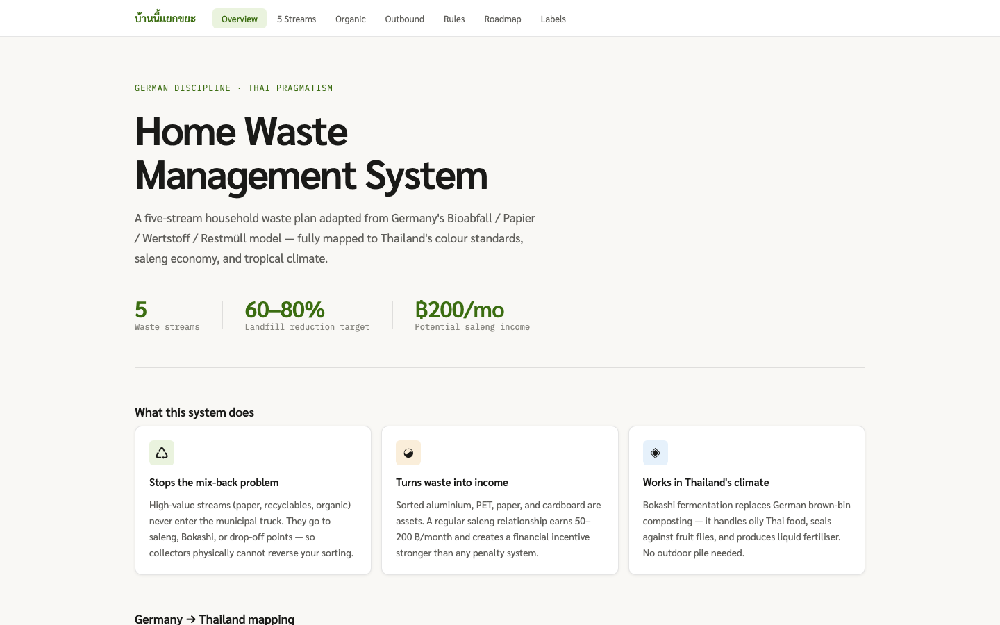

# Household Waste Management System — Thailand

[](https://unknown-x0.github.io/Household-Waste-Management-System/)
[](https://developer.mozilla.org/en-US/docs/Web/JavaScript)

A proposal website adapting **Germany's 4-stream waste model** (Bioabfall · Papier · Wertstoff · Restmüll) to Thai households: their infrastructure, the saleng economy, and the tropical climate. It covers sorting guides, Bokashi composting, local recycling routes, a four-week rollout plan, and printable Thai labels.

**[Open Household Waste Management System →](https://unknown-x0.github.io/Household-Waste-Management-System/)**



## Features

- **Overview:** a summary and the Germany → Thailand stream mapping table.
- **5 Streams:** bin specs, yes/no sorting lists, bag colours, and bin sizes.
- **Organic / Bokashi:** a four-step Bokashi guide, compared with a compost pile and a worm farm.
- **Outbound Flow:** the anti-mixing strategy and the saleng, GEPP, and WONGPANit routes.
- **Rules & Penalties:** violation fines, a reward system, and an onboarding checklist.
- **4-Week Roadmap:** the setup plan, weekly and monthly maintenance, and pest control.
- **Thai Labels:** printable bilingual bin labels and bag tags.

## Getting started

### Use it online

Open the [live site](https://unknown-x0.github.io/Household-Waste-Management-System/) and move between the tabs.

### Run it yourself

Open `index.html` in a browser; there is no build step.

```sh
git clone https://github.com/UNKNOWN-X0/Household-Waste-Management-System.git
open Household-Waste-Management-System/index.html
```

## Usage

### Thailand adaptations

| German original | Thai adaptation |
| --- | --- |
| Brown bin collected by municipality | Bokashi fermentation at home |
| Yellow bag (Gelber Sack) weekly pickup | Saleng relationship or GEPP / WONGPANit app |
| Paper (Blauer Sack) municipal stream | Bundle for saleng — sells at 3–8 ฿/kg |
| Legal mandatory sorting with fines | Household penalty jar — 20 ฿/violation |
| Sondermüll drop-off centres | Big C / HomePro / อบต. hazardous waste days |

> **Golden rule:** Only the blue residual bag ever goes into the municipal truck. All other streams have dedicated separate routes.

## Privacy

The onboarding checklist remembers its ticks in the browser's local storage. Nothing else is stored, and the page sends nothing anywhere.

## Development

### Design

| Element | Choice |
| --- | --- |
| Fonts | Sarabun (Thai + Latin) · IBM Plex Mono (labels) |
| Primary | `#3B6D11` green · `#BA7517` amber |
| Stream colours | Thailand national bin colour standard |

## Tests

No automated tests yet.

## Project structure

```text
index.html          Content and structure (the page is mostly content)
style.css           Design system and responsive layout
app.js              Tab navigation, animations, checklist persistence (a small script)
assets/preview.png  Screenshot for this README
```

Keep content, behaviour, and styles separate; add script modules only when the interactive code grows.

## Project documents

| File | What it covers |
| --- | --- |
| [ROADMAP.md](ROADMAP.md) | What is planned next, with an issue per item |
